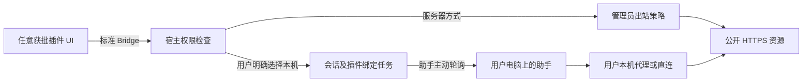

# v1.2 本机公开资源读取助手合同

> 最新更新时间：2026-11-15（Asia/Shanghai）
> 状态：通用可选能力；RSS Publisher 2.1.0 为消费者之一。

## 读取位置与权限

`web.public.read` 继续提供服务器读取，服务器代理由管理员通过部署配置统一维护。新增可选 `web.local.read`，需要签名包声明、管理员批准、本人用途同意及当前用户安装/启用，才能配对或使用本机客户端。没有本机能力批准时，服务器读取仍可使用。

本机代理只由用户在自己的助手启动参数、交互输入或 `CAMPUSOS_COMPANION_PROXY` 环境变量中设置。支持 HTTP/HTTPS CONNECT 与 SOCKS5；空值直连。地址、用户名、口令不上传，也不接受服务器下发代理配置；服务端只收到 `direct/http/https/socks5` 状态。用户和插件仍不能查询、修改、关闭或覆盖服务器代理。



## 通用 Bridge

- `web.clients.status {}`：返回 `clients`、`local_available`、`selected_client_id`，客户端视图仅有 id/name/online/expires_at/proxy_mode。
- `web.clients.pair {}`：宿主确认用途后返回单次 pairing_code、expires_at 和本站地址。用户在自己的助手输入代码；配对不会自动切换读取位置。
- `web.clients.select {client_id?}`：宿主确认后选择当前用户、当前会话和当前插件版本的在线客户端；省略编号表示用户明确切回服务器。
- `web.clients.disconnect {client_id}`：撤销该客户端。已选择的编号保留为不可用状态，不能自动改用服务器。
- `web.clients.download {platform}`：宿主下载部署者已构建的固定程序，不向插件转交二进制或文件路径，不自动执行。
- `web.read {url,kind,client_id?}` 与 `editor.article.import {...,client_id?}`：本机编号固定文档、预览图片和导入图片的读取位置；不接受 proxy/profile/media_profile 等服务器策略字段。

宿主用当前用户/插件范围的摘要作为 sessionStorage 键，仅保存已确认的客户端编号。配置变更导致 iframe 重载后保留选择。登录凭据刷新轮换会让旧助手失效，界面保留不可用的原编号，要求重新配对或明确切回服务器；服务端按真实会话拒绝跨会话复用。每次读取及导入前后核对选择，切换后旧结果不能继续导航或混用另一条网络路径。sessionStorage 中没有 JWT、助手令牌或代理凭据。

## HTTP 与短期凭据

`POST /plugin-v5/:publisher/:key/:version/ui-actions` 承载以上配对/状态/选择/断开与公开读取，继续验证 User JWT、当前会话、浏览器 CSRF、当前 UI proof、不可变包、Grant/Consent。服务器额外返回的 scope 只供宿主绑定本地选择，插件不会取得 JWT 或助手令牌。

助手仅主动连接 `/api/v1/web-companion/connect`、`poll`、`result`，没有本地监听端口，无需浏览器访问 localhost 或放宽 CORS。

- connect：精确字段 pairing_code/name/proxy_mode，拒绝代理地址和附加字段；一次性 128 位代码，两分钟有效。
- poll/result：使用独立 256 位 opaque Bearer，不能作为 User/Admin JWT；令牌只存内存，服务端仅留摘要，最长两小时。
- 原浏览器 Origin、Cookie、Sec-Fetch-Site 请求拒绝，原生协议不兼作浏览器跨站入口。
- 令牌绑定本人真实会话、插件坐标/包、生命周期代次、Grant/Consent。退出、过期、撤权、停用、升级或卸载后失效，重新启用也不恢复旧令牌。
- 普通配置变更只更新 UI proof，保留客户端连接；每个任务另固定当前 UI proof，配置变化后迟到内容丢弃。安装 JSON 的 companion_generation 用于此生命周期区分，没有新增核心 DDL。
- 代码与客户端各最多 64 项；每客户端 2 个排队任务、全局 16 个任务、单客户端仅一个轮询。轮询 10 秒，离线判定 30 秒；有界清理、过期、重放及跨 owner 拒绝。

任务仅包含 id/url/max_bytes，固定只读 GET。服务器先校验公开 HTTPS/DNS，本机再次独立校验本机 DNS 所有答案、固定公网 IP 并检查原站 TLS；不能使用 socks5h 绕过校验。每文档/图片最多 1 MiB、网络读取最多 8 秒，源站不收到平台凭据、助手令牌或代理认证。返回内容不可信，图片继续经过宿主解码/压缩，正文继续清洗和本人手动发布。

选定本机后，断线、拒绝或超时均报错，不回退服务器。用户必须明确重新配对并选择，或明确切回服务器。主机间不共享 localhost：助手中的 127.0.0.1 是用户电脑，服务端配置中的回环地址是 API 所在机器/容器。

## 构建、下载与运行

```bash
python3 scripts/build-web-companion.py
# 可按平台构建，或将产物写到部署者选择的受管目录
python3 scripts/build-web-companion.py --platform windows-amd64 --output /path/to/client-tools
```

固定支持 Windows x64、Linux x64/ARM64、macOS Intel/Apple 芯片，产物与 SHA256SUMS.json 默认位于被忽略的 `.campusos/tools/web-companion/`。部署者设置 `CAMPUSOS_WEB_COMPANION_TOOLS_DIR` 指向 API 可读目录；容器需显式挂载已构建产物。插件安装、启用、配置和卸载都不构建程序、安装依赖或修改宿主源码/系统文件。

下载接口为登录用户的 `GET /api/v1/web-companion/tools/:platform`。仅允许固定平台名、普通文件和 32 MiB 上限；Root 限定目录、拒绝符号链接及文件替换，响应提供 X-Companion-SHA256。没有构建物时返回不可用，不生成或执行命令。

Windows 可直接运行下载的 exe，按提示输入本站地址、本机代理和配对码，也可指定地址及代理：

```powershell
.\campusos-web-companion-windows-amd64.exe --server http://10.0.0.10:3000 --proxy http://127.0.0.1:7890
```

Linux/macOS 在终端赋予运行权限后启动，例如：

```bash
chmod +x ./campusos-web-companion-linux-amd64
./campusos-web-companion-linux-amd64 --server http://10.0.0.10:3000 --proxy socks5://127.0.0.1:7891
```

地址及端口按实际情况替换，留空代理使用直连。含认证的代理可通过本机环境变量传入，避免把口令写入公开命令记录。配置仅供当前助手进程，不修改系统/浏览器/Clash；与本站的控制连接始终独立直连，不把助手凭据送入内容代理。非隔离开发环境使用 HTTPS；HTTP 仅接受用户明确指定的可信私网/回环 IP。

## 验证入口

Go 测试覆盖配对/owner/当前授权/失权/过期/重放/结果上限、配置保活及停用后不可复活；Web 测试覆盖显式选择、配置重载、本机图片导入与禁止隐式回退。

`python3 scripts/verify/web-companion/fixture.py` 使用专属数据库、真实签名包、浏览器和原生 Linux 助手；`CAMPUSOS_RSS_E2E_PROXY=socks5` 验证 SOCKS5。服务端故意选用拒绝代理，只有本机代理转发才可完成读取、图文导入和手动发布。测试同时核对 Windows 下载字节、断开撤权与宿主文件指纹。跨平台构建不等于 Windows/macOS 真机运行验收。
